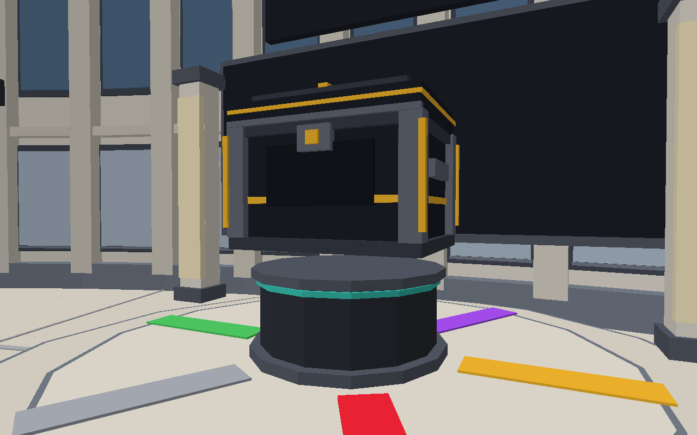
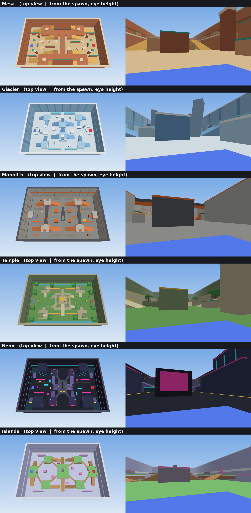

# Sniper Duel (Roblox, Luau + Rojo)

A 1v1 first-person sniper duel with fast, momentum-based movement and
ROUNDS-style roguelike progression. Best of 9 (first to 5 round wins). After
each round, the player who **died** picks 1 of 5 random power-up cards. Cards
stack for the rest of the match, so the losing player gets stronger each round.

Everything (map, viewmodel, UI, icons) is built from flat, single-colour
SmoothPlastic parts and frames. The project uses no images, meshes or
textures, so it runs as soon as it's synced.

---

## File structure

```
default.project.json          Rojo project: maps the folders below into Roblox
rokit.toml                    pins the Rojo version (optional, for Rokit users)

src/shared/                -> ReplicatedStorage.Shared   (server + client)
  Config.lua                  ALL tunable numbers + colour palette + sounds + lighting
  PowerUps.lua                every power-up as one data entry + card drawing
  Ballistics.lua              bullet tracing (ghost / ricochet / homing / split shot)
  GunModel.lua                the sniper rifle + a visual mod for every power-up
  Remotes.lua                 list of every RemoteEvent
  Signal.lua, Util.lua        small helpers
  Logo.lua                    the SNIPER DUEL logo (crosshair mark + wordmark, GUI frames)
  CrateModel.lua              the loot crate model (hinged lid, rarity glow)
  KnifeModel.lua              the combat knife (imported mesh or built from parts)
  Skins.lua                   paints the rifle / knife in a skin (colours, finish, glow, sparkles)
  Cosmetics.lua               tracers, kill effects, poses, titles (lookups)

src/server/                -> ServerScriptService.Server
  Main.server.lua             entry point, starts every service
  LightingSetup.lua           Future lighting + post effects (arena profile)
  CrateService.lua            crate keys, server-side rolls, owned + equipped skins (DataStore)
  RankService.lua             ranked rating (Elo, DataStore) + the lobby leaderboard wall
  MapBuilder.lua              builds the lobby and the arena from parts
  ArenaMesa / Glacier / Monolith / Temple / Neon / Islands.lua   the six huge maps in the rotation
  DummyService.lua            practice dummies on the lobby shooting range
  CharacterService.lua        spawning, flat character style, freeze, invisibility, void
  MatchService.lua            lobby, queue, matchmaking, arena slots
  Match.lua                   one match: countdown, rounds, scoring, power-up picks, victory
  CombatService.lua           server-side hit validation, damage, power-up abilities
  BotService.lua              computer opponent for admin "/bot" matches (AI + fake player)
  SettingsService.lua         saves settings + keybinds (DataStore)

src/client/                -> StarterPlayerScripts.Client
  Main.client.lua             entry point, starts every controller
  ClientState.lua             latest match snapshot, my power-up stats, settings
  Keybinds.lua                every rebindable action + its keyboard / controller default
  CameraController.lua        first-person lock, FOV kicks, tilt, recoil, sensitivity
  MovementController.lua      bhop, air control, sprint, slide, wall run, grapple...
  WeaponController.lua        scope + fire, local tracers, sends shots to the server
  EffectsController.lua       tracers, explosions, ropes, wallhack pulse, screen tints
  LightingController.lua      blends arena / indoor lobby lighting (Config.Lighting)
  CrateController.lua         the lobby crate + its opening cinematic
  KnifeController.lua         the knife: switching, slashes, stabs, hit checks
  BodyAnimator.lua            your real character holds + animates the weapons (everyone's, every frame)
  WeaponAnim.lua              every weapon animation (rifle + knife moves, spline keyframes)
  BodyRig.lua                 bends a real R15 character: torso twist, arm IK, weapon joint
  FirstPersonView.lua         first person: slim copies of your arms + weapon on the camera
  KillCamController.lua       the kill cam replay + the winner's victory pose
  UIController.lua            creates all screens
  Sfx.lua, Spring.lua         sound + spring helpers
  ui/
    Theme.lua                 fonts, colours, rounded corners, helpers
    Icons.lua                 draws flat power-up icons from shape data
    HUD.lua                   crosshair, scope, scoreboard + power-up icons, health, banners
    PickScreen.lua            the 5-card power-up pick screen
    VictoryScreen.lua         end of match screen
    LobbyUI.lua               lobby screen: logo, player card + keys, find match and the other actions
    CrateReveal.lua           the crate opening overlay (rarity climb, flash, reveal card)
    SettingsMenu.lua          General / Keyboard / Controller tabs: sliders, toggles, keybinds
    Toast.lua                 short messages from the server (admin commands)
    PowerUpLab.lua            try any power-up solo in the lobby (B)
    Locker.lua                pick your rifle and knife skins (L)
    Shop.lua                  crates, featured skins, credit packs (Robux), VIP pass (M)
    Welcome.lua               the one-time welcome card for new players

assets/SniperRifle.glb        PGM 338 rifle, ready for Studio's 3D Importer (CC-BY-4.0, see Quick start)

src/character/             -> StarterPlayer.StarterCharacterScripts
  Health.server.lua           empty script that disables health regeneration
```

---

## Quick start (no Rojo needed)

1. Download **`dist/SniperDuel.rbxlx`** (on GitHub: open the file, then click the
   download button).
2. Double-click it, or in Roblox Studio use **File > Open from File** and pick it.
3. **Solo:** press **Play** (F5). You spawn in first person with your sniper in
   the lobby. Shoot the dummies on the range and practise bunny hopping.
4. **A real duel:** **Test** tab > **Clients and Servers** > **2 Players** >
   **Start**, then press **F** in both windows to find a match.
5. **File > Publish to Roblox** if you want it on your account.

### Use the combat knife model (one-time import)

The knife works straight away with a built-in parts knife. To use the
combat knife model instead, import **`CombatKnife.glb`** the same way as
the rifle below (Import 3D, then Play). A model called **CombatKnife** goes
to ReplicatedStorage. The file isn't in this repo: the model is under the
Sketchfab Standard licence, which lets you use it in your game but not
share the file itself, so keep your copy of `CombatKnife.glb` somewhere
safe. It's already scaled and lined up (handle at the origin, blade
forward, edge down) and split into Blade and Handle, which the game paints
steel and black (`Config.Knife.MeshPaint`). Model: "Combat Knife" by
hamzagost32 (https://sketchfab.com/3d-models/combat-knife-06988a4cabc04fa58cec83ed0a9dee70).

### Use the PGM 338 rifle model (one-time import)

The place file can't contain meshes, so Studio has to import the rifle once:
1. In Studio: **Home** (or **Avatar**) tab > **Import 3D**, pick
   **`assets/SniperRifle.glb`**, and click **Import** (default settings are
   fine). A model called **SniperRifle** appears in the Workspace.
2. Press **Play**. The game moves it into ReplicatedStorage and uses it as
   the rifle for everyone (first person and in other players' hands). Save
   the place so you keep it.
3. If it ever shows up facing the wrong way, set `Config.Viewmodel.MeshYaw`
   to 90, 180 or 270. To go back to the built-in VX-7 rifle, delete the
   SniperRifle model or set `Config.Viewmodel.UseImportedRifle = false`.

This GLB is already scaled, turned and lined up with the game's grip, scope
and muzzle points. The hanging bipod legs are removed so they don't sit in
your view, and the meshes are split by colour (desert-tan body, gunmetal
parts, black scope and barrel, dark stock with lighter details). The game
paints each piece a flat colour (`Config.Viewmodel.MeshPaint = "Always"`),
so the rifle is coloured even if Studio's importer drops the textures; set
it to `"Auto"` to keep the imported textures instead. The whole bolt (the handle plus the bolt body
inside the receiver) is a separate piece: it turns up and slides back out of
the action when you chamber a round. If you imported an older
version of the file, delete the old SniperRifle model and import this one
again. Rifle model: "PGM 338 Sniper Rifle" by Alexandre P.
(https://sketchfab.com/3d-models/pgm-338-sniper-rifle-f32b57e4cecb491aa569358c9ae93b71),
licensed CC-BY-4.0. Keep this credit if you publish the game (e.g. in the
game description).

This file is a snapshot of the code. If you edit the `src/` files, rebuild it with
`rojo build -o dist/SniperDuel.rbxlx`, or use the live Rojo setup below.

## Setup: Rojo + Roblox Studio

### 1. Install Rojo (the command-line tool)

Pick **one** of these:

- **Rokit (recommended):** install Rokit from <https://github.com/rojo-rbx/rokit>,
  then in this folder run:
  ```
  rokit install
  ```
  (This reads `rokit.toml` and installs the pinned Rojo version.)
- **VS Code:** install the **Rojo** extension by evaera. It can install and
  run Rojo for you from the command palette ("Rojo: Open menu").
- **Manual:** download `rojo` for your OS from
  <https://github.com/rojo-rbx/rojo/releases> (7.4.x) and put it on your PATH.

Check it works:
```
rojo --version
```

### 2. Install the Rojo plugin in Roblox Studio

Run this once (with Studio closed):
```
rojo plugin install
```
Or search **"Rojo"** in the Studio Toolbox (Plugins tab), by *Rojo*, and install it.

### 3. Create the place and connect

1. Open Roblox Studio and create a new **Baseplate** place.
2. **Delete the Baseplate** part and the **SpawnLocation** from Workspace
   (the game builds its own lobby and arenas).
3. In a terminal in this folder run:
   ```
   rojo serve
   ```
4. In Studio, open the **Plugins** tab, click **Rojo**, then **Connect**
   (default `localhost:34872`). The scripts appear in ReplicatedStorage,
   ServerScriptService and StarterPlayer. Any file you edit now syncs live.
5. **Save the place** (File > Save to Roblox / Save to File). Rojo syncs code
   only; the place file is yours.

> Prefer a one-off file instead of live sync? `rojo build -o SniperDuel.rbxlx`
> and open that file in Studio.

### 4. Studio settings

- **Lighting > Technology** should read **Future** (the project sets it; double check).
- **Game Settings > Security > Enable Studio Access to API Services**: turn
  on if you want settings and keybinds to save between sessions (DataStores).
  The game works without it; settings just won't persist.
- Avatar type: R15 or R6 both work. R15 is recommended
  (Game Settings > Avatar).
- `StarterPlayer.LoadCharacterAppearance` is turned off by the project, so
  everyone gets the clean flat body.

### 5. Test with two players

A duel needs two players:

1. **Test** tab > **Clients and Servers** > set **2 Players** > **Start**.
2. Two client windows open. Press **PLAY** in both.
3. The match starts in one of the arenas after a 3-second countdown.

Single-player check: press **Play** (F5). The lobby is a first-person practice
area with a shooting range and moving dummies, so you can test movement and
the sniper on your own. You need a second player to start a match.

---

## Controls

Every key below can be rebound in **Settings (P) > Keyboard** or
**Settings > Controller** (controller defaults in brackets).

| Key | Action |
|---|---|
| WASD [left stick] | Move |
| Mouse [right stick] | Look |
| Hold Space | **Bunny hop**: re-jump the instant you land, keeping all your speed |
| A or D + mouse | **Air strafe**: in the air, hold A and turn left (or D and right) to gain speed |
| Left Shift | Sprint (hold) |
| W (in the air) | Steer your momentum toward where you look (keeps your speed) |
| C [B / O] | Slide (tap, tap again to stand). Press in the air to slide on landing. Jump out of a slide any time |
| Space | Jump / wall jump (no double jump unless you pick the Double Jump power-up) |
| (automatic) | Wall run, only with the **Wall Runner** power-up: jump next to a wall while moving and holding W |
| Right mouse | Scope (hold, or toggle in settings) |
| Left mouse | Fire |
| E | Grapple Hook (power-up) |
| R | Blink (power-up) |
| Q | Decoy (power-up) |
| Space (hold) | Ceiling run under a ceiling (Magnetic Boots) |
| V | Inspect your rifle (one of three: show it off, scope check, chamber check) or the knife (look it over, toss it and catch it) |
| 2 / mouse wheel [RB / R1] | **Knife** (1 or the wheel switches back to the rifle) |
| Left mouse (knife) | Slash, alternating left and right |
| Right mouse (knife) | Stab with a short lunge |
| B | **Power-Up Lab** (lobby / playground): try any power-up solo |
| L | **Locker** (lobby): equip rifle and knife skins |
| M | **Shop** (lobby): open crates, featured skins, credits, VIP |
| G | **Playground** (lobby): free roam on the match map with dummies |
| F [D-pad right] | Find a match / leave the queue (lobby) |
| U [R-stick click] | Duel a player: challenge someone in the server (lobby) |
| T [D-pad up] | Rematch your last opponent (lobby, shortly after a match) |
| N | Play against a bot (admins, lobby; no controller default since RB is the knife) |
| P [Select] | Settings (frees the mouse) |

Controller defaults: RT fire, LT scope, A jump, B slide, L-stick click sprint,
Y grapple, X blink, D-pad up decoy, D-pad down inspect, D-pad left Power-Up
Lab, LB playground.

---

## What to test after each stage

The code was written in five stages. All stages are in this repo, so you
can work through these checklists in order once it's synced.

### Stage 1: first-person camera and movement
Files: `Config`, `CameraController`, `MovementController`, `CharacterService`, `MapBuilder` (lobby)

- [ ] You spawn in the lobby in first person, scrolling can't zoom out, and you
      can't see your own body.
- [ ] Hold Space: you bunny hop. Hold A and turn the mouse left in the air: the
      speedometer climbs.
- [ ] Shift sprint is faster and the FOV widens slightly.
- [ ] Sprint, then tap C: you slide, the camera drops and tilts, and the FOV kicks out.
      Speed bleeds off and the slide ends on its own (or tap C again).
- [ ] Slide, then Space: you jump straight away and keep the slide speed.
- [ ] Space in the air does nothing (no double jump by default).
- [ ] Hold W in the air and look left/right: you curve that way without losing speed.
- [ ] Without power-ups you can't wall run. Add **Wall Runner** in the
      Power-Up Lab (B), jump next to the long lobby wall holding W: a short
      run (about half a second), no speed boost, and you sink fast. Space
      jumps off. You get one per jump (touch the ground to recharge) and
      there's a cooldown.
- [ ] Walking into walls doesn't stick or jitter, and you stop quickly when you let go of WASD.
- [ ] Tune feel in `Config.Movement` / `Config.Camera` while Rojo is connected.

### Stage 2: sniper and viewmodel
Files: `ViewmodelController`, `WeaponController`, `Ballistics`, `CombatService`, `EffectsController`

- [ ] In the lobby (and in matches) you see gloved arms holding the sniper. It
      swings up into view when you spawn, dips when you jump, slams on hard
      landings, and V inspects it. Shoot the range dummies: they flash, lose
      health and respawn.
- [ ] The rifle sways when you move
      the mouse, bobs when you walk, lowers when you sprint and tilts while sliding.
- [ ] The small crosshair shows in the centre.
- [ ] Right mouse: the gun slides to centre, the FOV zooms in, the scope overlay
      appears and the crosshair hides. Scoped sensitivity is used.
- [ ] Left click: recoil kick, a tracer from the muzzle, a bolt-action animation
      with a click sound, and you can't fire again until it finishes (bar under the crosshair).
- [ ] Hit the enemy: a white X snaps in with a ping and a crisp tick. Headshot:
      red X and a ding. Kill: a bigger red X with a wider one flying out, a
      low thump under the kill sound (and the ding on a headshot kill).
      A body shot does 72 damage, so it takes two.
- [ ] The enemy sees your tracer coming from your third-person gun.
- [ ] Server validation: firing faster than the bolt (e.g. with a modified client)
      or from far away from your body is rejected and logged in the server Output.

### Stage 3: rounds and scoring
Files: `MatchService`, `Match`, `HUD`, `LobbyUI`, `VictoryScreen`

- [ ] PLAY in both clients: the queue status updates, then both are teleported to
      opposite spawns, frozen, with a 3-2-1 countdown, then GO.
- [ ] The scoreboard at the top shows names and round wins (e.g. 2 - 1), the round
      number and a round timer.
- [ ] Killing the enemy shows ROUND WON / ROUND LOST (and HEADSHOT when it was one).
- [ ] The first to 5 wins sees VICTORY, the other DEFEAT, with the final score.
      Both return to the lobby with the normal camera.
- [ ] One player leaving mid-match gives the other the win ("OPPONENT LEFT").
- [ ] Falling out of the map kills you. The reset button is disabled.

### Stage 4: power-ups
Files: `PowerUps`, `PickScreen`, `Icons`, plus power-up code in Movement/Weapon/Combat/Effects

- [ ] After each round the loser sees 5 cards flip in one by one: rarity-coloured
      glow, icon, name and description, with no duplicates. The mouse is free.
- [ ] Legendary cards shimmer and play a deeper sound when they flip.
- [ ] Hovering lifts and brightens a card. Clicking plays a pick animation.
- [ ] The winner sees the same cards ("X IS CHOOSING") and can't click them,
      then sees which one was picked.
- [ ] Let the 15s timer run out: a random card is picked.
- [ ] Collected power-ups show as small icons under each name on the scoreboard.
- [ ] Each power-up does what its card says. Test them **solo** in the lobby:
      press **B** to open the Power-Up Lab, left click power-ups to add them
      (right click removes), close it and try them on the range dummies.
      **DRAW 5 CARDS** opens the real pick screen with random cards.
      (Second Wind and Vampire need a real opponent: use a 2-player Studio test.)

### Stage 5: map, rifle and visuals
Files: `ArenaMesa`... (the maps), `GunModel` (rifle + power-up mods), `ViewmodelController`, `MapBuilder`

- [ ] Each map: spawn behind your cover wall, climb the big ramps, and check
      every map in the rotation (`Config.Match.Maps`).
- [ ] With the imported rifle (see Quick start): the PGM 338 is in your
      hands, the scope lines up when you aim, and your hands sit on the grip
      and under the handguard.
- [ ] Open the Power-Up Lab (B) and add power-ups: each one adds an
      attachment, and the rifle animates differently (see "Power-up
      animations" below). Hair Trigger: the rifle spin-cocks after each shot.
      Ricochet: kills spin the barrel. Quickdraw: the rifle twirls into your
      hands when you spawn.
- [ ] Other players see the same rifle and attachments in your hands.

---

## The lobby


A round, enclosed hall (a rotunda) with a roof. Paved, lamp-lined paths lead
from the centre to alcoves around the curved wall:
- **Centre**: a sunken ring with smooth steps, where you spawn around the
  monument: the SNIPER DUEL crosshair as two slim crossed rings (white
  stone with a teal pinstripe, the crosshair's ticks pointing in and a
  glowing dot in the middle) on a tiered
  plinth in a shallow pool, lit from below. A ring of columns holds up a
  glass skylight dome; between them hang banners with the
  SNIPER DUEL logo, trimmed in team colours.
- **North**: a tunnel into the shooting range, a long indoor hall: clean
  white walls with pilasters, a roof with two long light strips, a firing
  line with booths and glass dividers, lane lines and a floor marker every
  50 studs, hanging distance boards, cover for the moving dummies and a big
  bullseye on the back wall.
- **East**: the duel area, a raised dais with team-coloured pads under a
  canopy (find a match with F, or duel a player with U).
- **West**: the crate vault: a round dais with a rarity ring, the crate
  floating over its altar, an odds board on the wall and two light pillars
  (see "Crates" below).
- **South**: the stage with the logo sign, speakers and a light rig.
- **Diagonals**: the Playground portal, an indoor garden with a pond, a
  parkour corner (ramp, boxes, rising blocks) and a quiet corner with a tree
  and two benches.
- The walls have framed panels, windows, pilasters, a cornice and soft
  sconces; the ceiling has beam rings and hanging lights. A glass railing
  runs round the sunken centre, the centre floor has a tiled star, the
  columns are fluted with potted shrubs, the planters between the paths
  hold rows of round leafy bushes, and there are bins by the paths. Lights are kept soft (`LIGHT_SCALE` in `LobbyBuilder.lua`).

It's built in `src/server/LobbyBuilder.lua`.

## Crates



There are two crates. Open them from the **SHOP** (press **M**, or the SHOP
button) or at the crate vault's altar (west side of the lobby, **X**, which
opens a Standard crate). Each one unlocks a rifle or knife skin.

| | Standard crate | Elite crate |
|---|---|---|
| Costs | 10 **Keys** | 250 **Keys** |
| Common (grey) | 62% | - |
| Uncommon (green) | 25% | - |
| Rare (blue) | 9.5% | 70% |
| Epic (purple) | 3% | 22% |
| Legendary (gold) | 0.5% | 7.2% |
| Secret (red) | - | 0.8% |
| Elite-only skins | no | yes |

What the rarities look like: Common = plain recolours; Uncommon = glossy,
two-tone, wood; Rare = chrome, metal, marble, rust, ice; Epic = glowing
trims; Legendary = gold, the glow pulses, glitter and flames; Secret = their
own weapon models.

Skins are the same rifle and knife models in new paint: every part belongs
to a paint group (body, metal, scope, bolt, trims, blade, handle) and the
skin colours each group (`Skins.lua`, the list is `Config.Crates.Skins`).
There are 58 rifle skins and 44 knife skins. They include plain colours
(Field Grey, Olive Drab, Navy...) and glossy two-tones (Cherry, Royal,
Sunset...). There are real materials (Walnut wood, Marble with gold,
Granite, Copper, Rustbucket, Glacier...) and glowing Epics (Neon Tiger,
Venom, Ghost...). The Legendaries are Hologram, Crystal, Aurora, Midas and
Magma. **Elite-only** skins are Galaxy, Plasma, Diamond, Glitch and Phoenix.
The **Secrets** are Dragonfire, Void Reaper and Celestial (rifle) and Shadow
Karambit, Bloodfang and Starforged (knife).

### Secret models

Each Secret is meant to be its own weapon model. Until you add one, its
skin uses its colours, glow, pulse, glitter and aura on the normal model,
so it already works. To give it its own model:

1. Import the model in Studio and put it in a Folder called
   **SecretWeapons** in the Workspace (the server moves it to
   ReplicatedStorage at start).
2. Name the model like the skin's `Template`: `Dragonfire`, `VoidReaper`,
   `Celestial`, `ShadowKarambit`, `Bloodfang` or `Starforged` (or add your
   own skin entries in `Config.Crates.Skins` with `Rarity = "Secret"`,
   `Elite = true`, `Template = "YourModel"`).
3. Optional: put an Attachment named **Grip** where the right hand holds
   it (rifle: the pistol grip; knife: the middle of the handle), so the
   hand lines up. Without it, it's fitted to the normal rifle / knife's size
   and position.

The model keeps its own textures; the skin adds its glow, glitter and aura.

## The shop and Robux

**Keys** are earned by playing: 3 for a win, 1 for a loss, and new players
start with 10 (one free Standard crate). They open both crates, and can also
be bought in the shop. **Credits** are bought with Robux and buy the
FEATURED skins outright. Your keys and credits show at the top right of the
lobby.

The SHOP has four tabs:

- **CRATES**: open either crate.
- **FEATURED**: three skins (each with a spinning 3D preview) and two
  cosmetics a day (a new set every day, UTC), bought outright with
  Credits. Prices: Common 40, Uncommon 80, Rare 160, Epic 320, Legendary
  700.
- **CREDITS**: credit packs. These are Developer Products: 100 credits for
  79 R$, 550 for 399, 1200 for 799 and 2600 for 1499. There's also a key pack
  (30 keys for 49 R$; bought keys open crates but can't be wagered).
- **VIP**: a Game Pass (299 R$) that gives 2x keys from every match and a
  gold VIP tag.

**Regions:** in countries where paid random items aren't allowed
(`PolicyService`), the key pack is hidden, so crates are earn-only there.

## Cosmetics: tracers, kill effects, poses, titles

Equip these in the LOCKER (L), on its TRACER, KILL FX, POSE and TITLE tabs.
Everyone sees them.

- **Tracers**: the colour of your bullet trails. There are Gold, Cyan,
  Lime, Hot Pink, Violet, Crimson and Void.
- **Kill effects**: what happens to the body when you get a kill:
  - Shatter (the default)
  - Confetti
  - Vaporize
  - Inferno (flames)
  - Thunderstrike (a lightning bolt from the sky)
  - Black Hole (a dark sphere swallows the body)
- **Poses**: your victory pose when the kill cam cuts to you. There are
  Fist Pump, Salute, You're Next (pointing at the camera) and Bye Bye
  (waving).
- **Titles**: shown in a tag over your head, next to VIP. There are Rookie,
  Sharpshooter, Knife Master, Sniper God and S1 Veteran. **Diamond** and
  **Champion** unlock by themselves when you reach that rating in ranked.

They're sold in the SHOP's daily FEATURED items (two a day), and the ranked
titles unlock from your rating. The list is in `Config.Cosmetics`, the
lookups in `Cosmetics.lua`.

**To start selling:**

1. Create the products on the Roblox website: Creator Hub > your
   experience > Monetization > Developer Products, and one Pass.
2. Paste their ids into `Config.Shop`. An id of 0 means "not set up yet":
   the shop shows the item but says it isn't set up.

Purchases are granted by the server (`CrateService.lua`, ProcessReceipt).
Each purchase is granted exactly once: purchase ids are kept in the save,
and Roblox is only told it's done after the save went through.

**Locker**: press **L** in the lobby (or the LOCKER button, SKINS on
touch) to see every skin for each weapon, owned or locked, with a spinning
3D preview. EQUIP puts it in your hands; the server checks you own it,
saves it, and everyone sees it. Changes made during a match apply from
the next round.

In Studio, crates take keys like in the real game, but you're topped up to
1000 keys (`Config.Crates.StudioKeys`) so you can test as much as you like.
Set `FreeInStudio = true` to make opening free there.

**Daily reward**: the first visit each day (UTC) gives keys: 3, 4, 5, 6, 8,
10, then 15 for 7+ days in a row (`Config.Crates.DailyKeys`). New players
also get a one-time welcome card with the main keys.

**The opening**: the camera swoops in and the crate lifts, spins faster and
shakes while sparks are sucked into it, over a heartbeat that speeds up.
Its glow climbs the rarity ladder (COMMON, UNCOMMON, RARE...), slower with
every step, and stops on what you got. Then it teases: the glow flickers
toward the next rarity... and falls back. Everything stops dead for a
breath, the crate trembling. Then the lid blasts
off with a flash, a pillar of light, a shockwave and sparks in the rarity
colour, and the rifle (or knife) rises out of the crate in the skin's colours. The
rarity name slams in over spinning light rays. Legendary and Secret rain
confetti. Secret fakes you out first: the climb stalls on Legendary and goes
dark, then cracks red, and the title glitches. Press **X** to open another,
or **Space** to go back.

The roll happens on the server (`CrateService.lua`), which checks that you're
in the lobby and can pay. Keys, credits and owned skins are saved
in a DataStore (in Studio this needs Game Settings > Security > "Enable Studio
Access to API Services"). Rarities, odds, key rewards and the skin list are in
`Config.Crates`.

## Ranked and the leaderboard

Every match between two players is ranked (matches against the bot are
not). Your rating starts at 1000; win and it goes up, lose and it goes down.
Beating someone rated above you is worth more (Elo), and your first 5
matches swing more. Leaving a match counts as a loss.

| Tier | Rating |
|---|---|
| Bronze | 0+ |
| Silver | 900+ |
| Gold | 1100+ |
| Platinum | 1300+ |
| Diamond | 1500+ |
| Champion | 1700+ |

Your tier and rating show in the RANK chip at the top right of the lobby,
and after each match you get a message with the change ("RANKED UP!" when
you cross a tier). The **TOP SNIPERS** board on the south-west wall of the
lobby lists the 10 best players, refreshed every minute. Ratings are saved
in a DataStore (`RankService.lua`, tune in `Config.Rank`).

## Your character does the animations

**Your real character** holds the rifle and the knife, and that's what
everyone else sees.
- In first person you see slim copies of your own arms (your avatar's arm
  parts, with your shirt and skin) holding a copy of your own weapon, drawn
  on the camera so they never lag. They play exactly the same animation as
  your real body; full-size arms would fill the screen. Sizes:
  `Config.Body.FirstPerson`. Code: `FirstPersonView.lua`.
- Every move bends your actual body: the arms reach for the weapon with
  two-bone IK (elbows bend naturally), the torso twists and leans, the head
  follows your aim, and the legs step into a stab.
- Everyone sees the same animation on your character: shots (recoil + the
  bolt), knife swings, stabs, inspects and weapon switches are synced by the
  server, so other players and the kill cam show exactly what you did. Seen
  from outside, weapons are held a bit lower (chest / waist height,
  `Config.Body.ThirdPersonOffset`).
- The rifle and knife are jointed to your right hand, so the knife can be
  flipped, tossed and caught and the bolt really slides.
- The kill cam uses copies of both real characters: you watch through the
  killer's eyes (their arms and weapon, in first person), and your copy runs, jumps,
  aims and holds its weapon like you did.

Code: `BodyAnimator.lua` (runs it), `WeaponAnim.lua` (all the moves),
`BodyRig.lua` (the joint maths).

## Hitboxes

Every character gets three invisible boxes, the same size for every avatar:
head (headshot), body and legs. Bullets and the knife only hit those; real
body parts, arms and accessories are ignored, so swinging arms or bulky
avatar meshes never block or steal a shot.

## The knife

Press **2** (or scroll, or RB on a controller) to pull out the knife; **1**
or scroll again goes back to the rifle. Every life starts with the rifle.
- **Draw**: up from the hip, a full flip in the air, caught in your grip.
- **Slash** (left click): a short cock back, then one fast, clean diagonal
  swipe across in front of you, edge first, and back to the guard.
  Alternates forehand and backhand, with a glowing trail on the blade.
  40 damage.
- **Grip**: your fist closes round the handle with the forearm running
  back from it, so the arm never twists round when the knife turns.
- **Stab** (right click): drawn back by the shoulder, then a lunge where you
  lean in, dip and step forward, drive it in, twist, and rip it out.
  70 damage, a bit more reach.
- **Backstab**: any hit from behind is a kill ("BACKSTAB" banner).
- **Inspect** (V): bring it up and look along the blade, tip it up to check
  the edge, toss it once and catch it. No wrist spinning: the knife turns
  over in the air, your hand just handles it.
- With the knife out you run 8% faster, and the rifle can't fire.
- Your arms follow the knife (two-bone IK from your shoulders), so slashes
  and stabs move your whole arm. Other players see the knife in your hand,
  held forward, and see your swings and stabs; the kill cam replays knife
  kills with the killer's knife.
- Hits are checked on the server: the knife must have been out for a
  moment, swings can't be faster than the animation, and the target has to
  be in range, in front of you and not behind a wall.

All the numbers are in `Config.Knife`. Code: `KnifeController.lua`

## Duels, rematches and the kill cam

- **Duel a player**: press U (or the DUEL A PLAYER button) in the lobby to
  see everyone in the server and challenge them. They get a card with
  ACCEPT / DECLINE (it expires after `Config.Match.InviteTime`).
- **Key wagers**: in DUEL A PLAYER, pick how many keys to bet (NONE, 5,
  10, 25, 50, or type any amount you can cover) before you hit CHALLENGE.
  Your opponent sees the bet on the invite ("WAGER: 25 KEYS EACH - THE
  WINNER TAKES 50") and agrees by accepting. Both stakes are held when
  the duel starts; the winner gets both. Leaving forfeits your stake, and
  a cancelled duel refunds both. Only keys you **earned** by playing can
  be bet. Keys bought in the shop open crates (they're spent first) but
  are never wagered, so nothing bought with Robux is gambled (Roblox
  rules).
- **Rematch**: after a match, a REMATCH button shows in the lobby for
  `Config.Match.RematchWindow` seconds. Your opponent gets an invite card;
  when both want it, a new match starts. Against a bot, the rematch starts
  straight away at the same difficulty.
- **Kill cam**: when your opponent kills you, you watch the last few
  seconds again through their eyes, ending in slow motion. You see THEIR
  arms (copied from their avatar) holding THEIR rifle with their power-up
  attachments, kicking and cycling the bolt on each shot. You are a copy of
  your real character: it runs, stands and falls with Roblox's normal
  animations, holds the rifle and aims where you were aiming. Then the
  camera cuts round to face the winner, who strikes a **victory pose**:
  rifle swung up onto the shoulder (or the knife raised) and a fist in the
  air. Press Space or tap to skip. Tune it in `Config.KillCam` (the pause
  after a kill, `Config.Match.RoundEndTime`, is long enough for it).

## Playing on mobile

On phones and tablets, on-screen controls appear automatically:
- Move with Roblox's thumbstick (left). Drag anywhere on the right side
  to look (Settings > Touch for sensitivity and scoped sensitivity).
- **FIRE** (big, right; you can keep dragging on it to aim), a small FIRE on
  the left, **SCOPE**, **JUMP** (hold to bunny hop), **SLIDE**, **RUN**
  (toggle sprint) and your ability buttons (HOOK / BLINK / DECOY) when you
  have those power-ups.
- **LAB**, **DUEL** and **MENU** at the top. The lobby buttons can be tapped.
- Touch players get the same light aim assist as controller players.
- Buttons press the same actions as the keys, so everything works the same.
  It's in `src/client/ui/MobileControls.lua`.

## Your avatar

You play as your own Roblox avatar (`Config.Player.UseAvatars`):
- Everyone is loaded at the standard body size (height, width, proportions),
  so nobody gets a smaller or bigger hitbox from their avatar. Faces,
  clothes, hair and accessories all show.
- Hats, hair and other accessories don't stop bullets: only the three
  hitboxes count (head, body, legs; see "Hitboxes").
- In a match, a blue or red outline shows which side each player is on.
- In first person you see your character's real forearms and hands (see
  "Your character does the animations").
- Bots keep the flat team-coloured look. Set `UseAvatars = false` for the
  flat one-colour characters everywhere.

## Settings and keybinds

Press **P** (controller: Select) or the SETTINGS button in the lobby.
- **General**: mouse sensitivity and scoped sensitivity; controller look
  sensitivity, scoped sensitivity, stick deadzone, invert Y and aim assist;
  field of view; hold or toggle scope. Sliders can be dragged, or moved with
  the D-pad on a controller.
- **Keyboard** / **Controller**: click an action, then press the new key or
  button (Esc cancels). RESET DEFAULTS puts everything back.
- Settings save between sessions (DataStore; turn on API access in Studio).
  Tune the defaults and slider ranges in `Config.SettingsDefaults`,
  `Config.SettingsLimits` and `Config.Controller`.

## Bot (admin command)

Play a full match against a computer opponent, e.g. to test builds.
- In the lobby press **N** (controller: RB), or type in chat:
  `/bot`, `/bot easy`, `/bot normal`, `/bot hard`. `/endbot` ends the match.
- Who counts as admin (`Config.Admin`): the game's owner (or the group owner),
  anyone in `UserIds`, and everyone while testing in Studio
  (`AllowEveryoneInStudio`). Set `BotForEveryone = true` to let all players
  use it.
- The bot runs around the map with pathfinding, strafes and hops when it sees
  you, needs a moment to react, and its aim gets steadier the longer it tracks
  you (faster movers are harder for it). It shoots through the same server
  checks as players and picks power-up cards when it loses a round.
- Difficulty numbers (reaction time, aim error, headshot chance, speed) are
  in `Config.Bot`.

## Collision and hitboxes

- Walls are single solid boxes. All the detail on them (pilasters, frames,
  glass, signs, railings, car trim...) has collision **and** bullet hits off,
  so nothing snags you and shots aren't eaten by decoration.
- Movement does a body-sized sweep every frame and slides you along walls
  instead of letting you push into them (fast bunny hops and slides can't
  tunnel through), and Blink stops short of walls.
- Stairs and fire escapes walk on a smooth invisible ramp under the visible
  steps; landings have invisible rails so you can't fall off.
- Tree leaves don't block movement but do block bullets and sight.
- Bullets only hit the fixed head / body / legs hitboxes (see "Hitboxes").

## Playground mode

Press **G** in the lobby. You're dropped into your own copy of the match map
(shared with anyone else in the playground) with practice dummies on the
high ground and in the lanes. Open the **Power-Up Lab (B)** and
try any build on the real map; press **G** again to go back to the lobby, or
**F** to queue for a match from there.

## Controller aim assist

Controller players get light aim assist (mouse players never do):
- **Slowdown**: your aim turns up to 30% slower when the crosshair is right
  on a target, so it's easier to stay on them.
- **Gentle pull**: while you move or use the right stick, the aim drifts
  very slightly toward the target's body (never the head), at most about
  3 degrees per second.
- It only works inside a small circle around the crosshair (4.5 degrees,
  smaller when scoped), only on targets you can actually see, and never on
  an invisible (Phantom Step) enemy or a decoy.
- Players can turn it off in Settings (P). Tune it in `Config.AimAssist`.

## Visual effects

Glowing tracers with a travelling bullet, muzzle flash lights, impact sparks
and smoke, ricochet flashes, fireball explosions with shockwave rings, kills
that shatter the body into shards, floating damage numbers, speed lines when
you're fast, landing dust, slide sparks, and animated UI everywhere (card
deal/flip/pick, banners, score pops, victory confetti). Tone any of it down in
`Config.Effects`.

## Power-ups and builds

There are 56 power-ups and almost all of them **stack**. Every card shows what
another copy adds ("STACKS: ..."). They're designed to combine into builds:

| Build | Cards | What happens |
|---|---|---|
| Pinball | Ricochet x4 + Pinball x2 + Shrapnel | every bounce adds +70% damage and sprays shards |
| Demolition | Explosive Rounds x3 + Split Shot + Shrapnel | five explosive bullets, each blast showers shards |
| Speedster | Adrenaline + Momentum Rounds x3 + Sky Sniper | bunny hop fast = up to +180% damage, more in the air |
| Assassin | Ghost Round + Wallhack Pulse + Marked | see them through walls, shoot through walls, marked targets take more |
| Gunslinger | Hair Trigger + Split Shot + Quickdraw | every hit re-chambers instantly |
| Storm | Static Charge x3 + Split Shot + Homing | near misses still zap for 60 |
| Tank | Thick Skin + Vampire + Second Wind x2 | survive two lethal hits a round |
| Glass | Glass Cannon x3 + Momentum Rounds | +90% damage (more when fast) on a 40 HP body |

**New in this version** (25 more):

| Power-up | Rarity | Effect |
|---|---|---|
| Acid Rounds | Rare | Your shot leaves a pool of acid that burns the enemy |
| Frost Rounds | Rare | Hits slow the enemy 35% and cut their momentum |
| Serrated Rounds | Rare | Hits add 22 bleed damage over 2.5s |
| Impact Rounds | Common | Hits shove the enemy hard |
| Disruptor Rounds | Rare | Hits jam the enemy's abilities for 2.5s |
| Railgun | Legendary | Bullets pass through every wall; bolt 50% slower |
| Double Tap | Legendary | Every other shot re-chambers almost instantly |
| Deadeye | Epic | Stay scoped 1.2s to charge your next shot: +35% damage |
| Last Stand | Rare | Below 40% HP: +30% damage, +15% speed |
| Executioner | Common | +30% damage against enemies below half health |
| Long Shot | Common | Up to +30% damage at long range |
| Keen Edge | Common | +35% knife damage |
| Hunter's Knife | Rare | Faster with the knife out; knife hits give a speed burst |
| Power Slide | Common | Faster, longer slides |
| Slingshot | Rare | Slide jumps go 35% higher and faster |
| Air Dash | Rare | Sprint in the air to dash (recharges on landing) |
| Kinetic Armor | Rare | 25% less damage while moving fast |
| Recall (X) | Epic | Rewind 3s in time and heal back up to 40 HP |
| Barrier Dome (Z) | Epic | A dome that stops all bullets for 3s |
| Smoke Grenade (3) | Rare | Throw a thick smoke cloud |
| Sonar | Rare | The enemy is revealed through walls when they fire |
| Regeneration | Common | Heal 5 HP/s after 3s without damage |
| Overshield | Common | Start each round with a 30 shield |
| Bloodlust | Epic | Hits give you 12 shield (up to 36) |
| Fight or Flight | Common | Taking damage gives +25% speed for 1.5s |

Every power-up has its own hand-drawn icon in `src/client/ui/IconArt.lua`
(the tile, rarity ring and gem are drawn by `Icons.lua`). To draw one for a
new power-up, add `IconArt.<Id> = art({}, ...)` there; without one, the
card falls back to the simple `Icon` shapes in its definition.

**Damage formula** (server side): base x Glass Cannon x Sky Sniper (airborne) x
Momentum (speed) x Pinball (hops) x Marked. Headshots always kill instantly.

Test them solo in the lobby with the **Power-Up Lab** (press B).

## Maps and rotation

Every match picks a random map from `Config.Match.Maps`, never the same
twice in a row. The map's name shows on the "ROUND 1" banner. Set
`Maps = false` to always play `Config.Match.Map`.

Six huge maps, each 560-620 long and 380-440 wide. The walls and ramps are
built at roughly twice your height, so you feel tiny. Every map is mirrored,
so both spawns are fair, with a cover wall in front of each spawn.



| Map | Layout |
|---|---|
| **Mesa** | a sandstone canyon: two 36-high cliffs along the sides, a 50-high upper level, a stone arch over a giant rock pillar in the middle |
| **Glacier** | an ice fortress: a split 32-high keep with a gate and bridge in the middle, a 70-high ice tower, raised corner forts, tilted ice boulders |
| **Monolith** | concrete megastructure: four 44-high towers paired by bridges across the map, ramps up every tower, a 100-high slab in the centre |
| **Temple** | jungle: a 3-tier stepped pyramid with a shrine on top, smaller pyramids on each side, giant trees (leaves stop bullets, you can walk through them) |
| **Neon** | a city at night: a raised plaza with a billboard, 96-high skyscrapers, rooftops with sloped bridges down to the plaza, neon trims |
| **Islands** | floating islands joined by plank bridges, a rock spire on the centre island; fall off and you just lose height (ramps back up from the floor) |

Each map is one file in `src/server/` (`ArenaMesa.lua`...), with its
playground dummy spots at the bottom. A name in `Maps` with no matching
`Arena<Name>` file is skipped.

## The rifle and power-up mods

Import `assets/SniperRifle.glb` (see Quick start) to use the PGM 338 model.
Without it, the game uses the built-in VX-7 below. Power-up attachments and
animations work on both.


The VX-7 is an angular two-tone rifle (light shell, dark metal) with glowing
energy lines, an energy cell on the side and a glowing round counter in the
magazine. It changes as you pick power-ups:
- The **glow lines** take the colour of your rarest power-up and flare
  white when you fire.
- Every power-up **bolts on its own part**, with an effect: Ghost Round
  shimmering phase fins, Ricochet glowing coils (more per stack), Split Shot
  side barrels, Homing a seeker module with a laser, Explosive Rounds a
  grenade canister and embers at the muzzle, Shrapnel spinning spikes,
  Static Charge crackling tesla coils with sparks, Pinball bumper rings,
  Momentum fins that glow as you speed up, Sky Sniper wings, Glass Cannon a
  white-hot barrel, Marked a red laser, Hair Trigger a gold trigger, Vampire
  a dripping blood vial, Bullet Time a ticking clock, Wallhack Pulse a
  spinning radar dish, Thick Skin armour plates, Second Wind a heart cell,
  Grapple a hook launcher, and so on. Movement power-ups hang a coloured charm.
- With 5 or more power-ups the handguard sparks.
- Your opponent sees the same rifle in your hands, so you can read their
  build. (Phantom Step hides the effects too.)
- Add or change mods in `GunModel.Mods`.

### Power-up animations

Your power-ups also change how the rifle moves in first person:

| When | Power-up | Animation |
|---|---|---|
| Firing | Explosive Rounds, Glass Cannon | heavy kick that shoves the rifle back |
| Firing | Split Shot | a double kick |
| Firing | Hair Trigger, Quickdraw | short, snappy kick |
| Firing | Static Charge | the rifle buzzes with electricity |
| Bolt | Hair Trigger, Quickdraw | spin-cock: the rifle spins once around the barrel |
| Bolt | Bullet Time | the rifle tilts up so you can admire it while you work the bolt |
| Bolt | Explosive Rounds, Split Shot | heavy pump, pulled back toward you |
| Bolt | Ricochet, Pinball | the rifle bounces |
| Spawning | Quickdraw | twirls into your hands |
| Spawning | Ghost Round | phases in |
| Idle | Ghost Round | floats |
| Idle | Momentum Rounds | leans forward as you speed up |
| Idle | Static Charge | random electric twitches |
| Idle | Vampire | heartbeat pulse |
| Kill | Ricochet, Pinball | barrel spin |
| Kill | Explosive Rounds | tilts up to blow the smoke away |
| Kill | Vampire | pulls the rifle in close |
| Kill | anything else | a quick nod |
| Inspect (V) | any power-up | turns the rifle both ways to show off the attachments |

They're in `ViewmodelController` under "Power-up animation styles".

## Bunny hopping

Movement uses the Source-engine model (Half-Life / CS / TF2):

- **On the ground**: friction, then acceleration up to run speed (30) or sprint speed (38).
- **In the air**: you can only add a tiny amount of speed *in the direction
  you're pressing* (`AirSpeedCap`), but there's no limit on total speed. When you
  strafe and turn the mouse at the same time, your input stays sideways to your
  velocity, so it keeps bending and growing. That's air strafing.
- **Holding Space** jumps again on the exact frame you land, before friction
  runs, so you lose no speed. Chain hops + air strafing = bunny hopping. Watch
  the speedometer under the crosshair (it turns teal when you're fast).
- **Tips**: don't hold W in the air. Hold only A or D and turn smoothly the same
  way. A slide (C) into a jump also starts a hop chain with extra speed.
- **Tuning** (`Config.Movement`): `AirAccel` and `AirSpeedCap` for strafe gain,
  `Friction` for how sticky the ground is, `MaxSpeed` for the speed limit, and
  `AutoBhop = false` if you want players to time each jump.

## Tuning and extending

- **All numbers live in `src/shared/Config.lua`**: movement speeds, slide/
  wall run, damage, bolt time, scope speed, server validation tolerances,
  power-up strengths, rarity weights, sensitivity defaults, palette, lighting
  and sound IDs.
- **Add a power-up:** add one entry to `PowerUps.Definitions` (name, description,
  rarity, icon colour, icon shapes, max stacks, `Effect`). If the effect only
  changes existing stats (health, jumps, bolt time, bullets, bounces...), you're
  done. For new behaviour, add a field to `baseStats()` and read it where the
  behaviour lives (see the comment at the top of `PowerUps.lua`).
- **Sounds:** `Config.Sounds` uses sounds bundled with the Roblox client
  (`rbxasset://sounds/...`). Swap any of them for `rbxassetid://<id>` from the
  Creator Store if you want different ones.

## How hit detection works (anti-exploit)

1. The client traces the bullet with `Ballistics` for instant tracers and sends
   `origin`, `direction` and what it saw itself hit.
2. The server rejects shots that come too fast for the (power-up adjusted) bolt
   time, start too far from the shooter's server-side head, have invalid
   numbers, or happen outside a live round.
3. The server re-traces the bullet with the **same** `Ballistics` code
   (ricochets, ghost walls, homing and split shot included) against the real
   map and the real enemy position.
4. Lag compensation: a client hit claim is only accepted if the claimed point
   lies on the server's own bullet path **and** near where that body part
   actually is on the server. A cheater can't shoot through walls or hit
   someone who wasn't there.

## Design notes

- **Bullet Time** is personal: Roblox can't slow the server clock for one
  player. While it's active you fall very slowly, drift at reduced speed, aim is
  steadier, your bolt cycles twice as fast and the screen tints.
- **Decoy** is a hologram copy of your character that runs in a straight line,
  follows the floor, stops at walls and pops when shot.
- Up to `Config.Match.MaxArenas` matches run at once in one server. Each
  gets its own copy of the arena.
