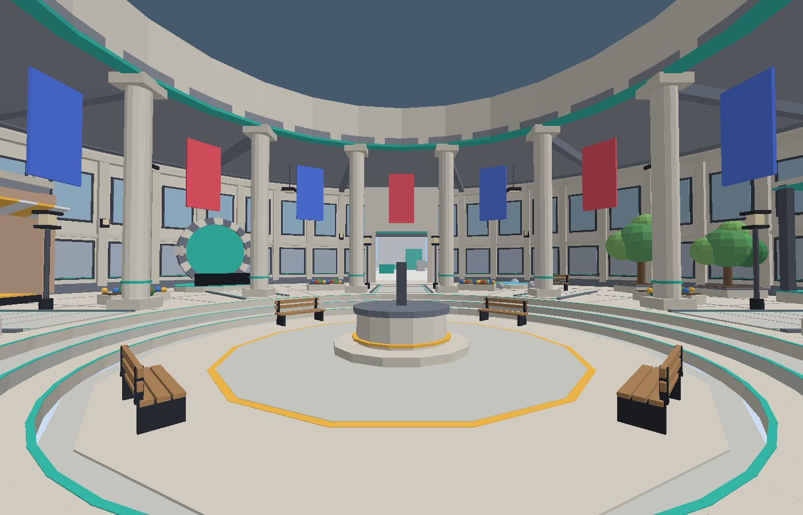
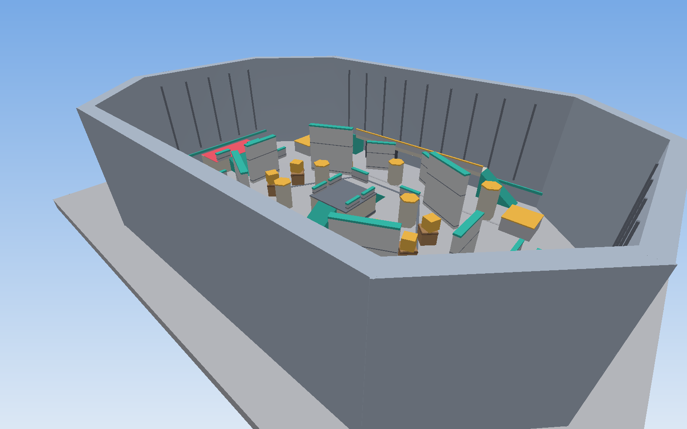
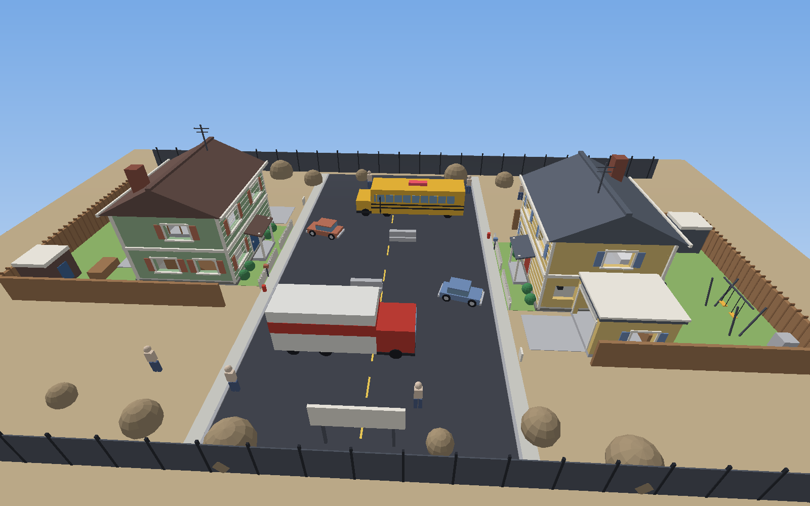
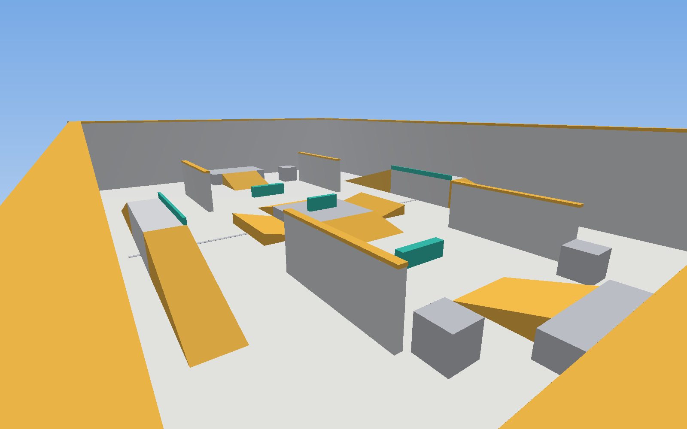
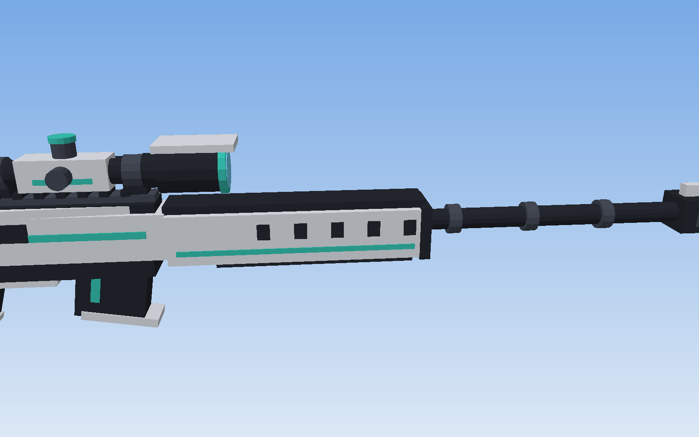
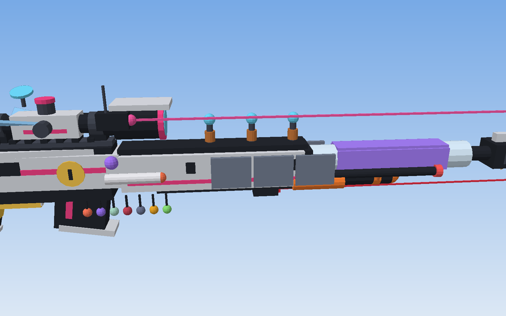
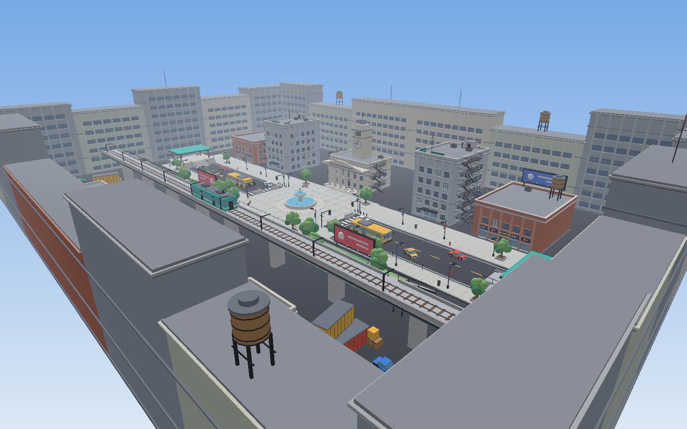
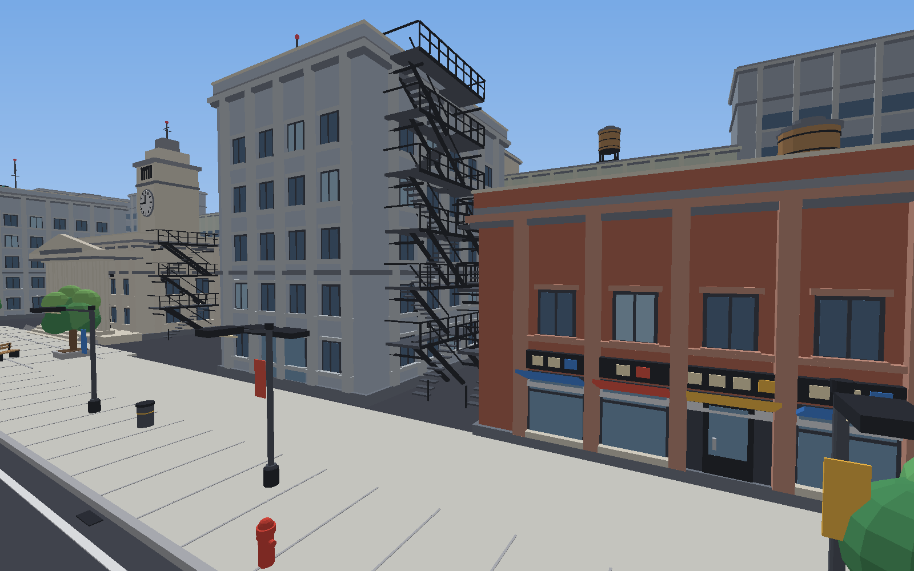

# Sniper Duel (Roblox, Luau + Rojo)

A 1v1 first-person sniper duel with fast, momentum-based movement and
ROUNDS-style roguelike progression. Best of 9 (first to 5 round wins). After
each round, the player who **died** picks 1 of 5 random power-up cards. Cards
stack for the rest of the match, so the losing player gets stronger each round.

Everything (map, viewmodel, UI, icons) is built from flat, single-colour
SmoothPlastic parts and frames. The project uses no images, meshes or
textures, so it runs as soon as it's synced.

---

## File structure

```
default.project.json          Rojo project: maps the folders below into Roblox
rokit.toml                    pins the Rojo version (optional, for Rokit users)

src/shared/                -> ReplicatedStorage.Shared   (server + client)
  Config.lua                  ALL tunable numbers + colour palette + sounds + lighting
  PowerUps.lua                every power-up as one data entry + card drawing
  Ballistics.lua              bullet tracing (ghost / ricochet / homing / split shot)
  GunModel.lua                the sniper rifle + a visual mod for every power-up
  Remotes.lua                 list of every RemoteEvent
  Signal.lua, Util.lua        small helpers

src/server/                -> ServerScriptService.Server
  Main.server.lua             entry point, starts every service
  LightingSetup.lua           Future lighting + post effects (arena profile)
  MapBuilder.lua              builds the lobby and the arena from parts
  ArenaPolygon.lua            the default map: compact Rivals-style arena, tall walls + ramps
  ArenaNuketown.lua           optional Nuketown cul-de-sac (Config.Match.Map = "Nuketown")
  ArenaCrossfire.lua          optional compact Rivals-style duel map
  ArenaSimple.lua             optional open ramps arena (Config.Match.Map = "Simple")
  ArenaDowntown.lua           optional detailed city map (Config.Match.Map = "Downtown")
  DummyService.lua            practice dummies on the lobby shooting range
  CharacterService.lua        spawning, flat character style, freeze, invisibility, void
  MatchService.lua            lobby, queue, matchmaking, arena slots
  Match.lua                   one match: countdown, rounds, scoring, power-up picks, victory
  CombatService.lua           server-side hit validation, damage, power-up abilities
  BotService.lua              computer opponent for admin "/bot" matches (AI + fake player)
  SettingsService.lua         saves settings + keybinds (DataStore)

src/client/                -> StarterPlayerScripts.Client
  Main.client.lua             entry point, starts every controller
  ClientState.lua             latest match snapshot, my power-up stats, settings
  Keybinds.lua                every rebindable action + its keyboard / controller default
  CameraController.lua        first-person lock, FOV kicks, tilt, recoil, sensitivity
  MovementController.lua      bhop, air control, sprint, slide, wall run, grapple...
  ViewmodelController.lua     arms + sniper on the camera (sway, bob, recoil, bolt)
  WeaponController.lua        scope + fire, local tracers, sends shots to the server
  CharacterPoser.lua          third-person rifle-holding pose for other players
  EffectsController.lua       tracers, explosions, ropes, wallhack pulse, screen tints
  LightingController.lua      blends arena / indoor lobby lighting (Config.Lighting)
  UIController.lua            creates all screens
  Sfx.lua, Spring.lua         sound + spring helpers
  ui/
    Theme.lua                 fonts, colours, rounded corners, helpers
    Icons.lua                 draws flat power-up icons from shape data
    HUD.lua                   crosshair, scope, scoreboard + power-up icons, health, banners
    PickScreen.lua            the 5-card power-up pick screen
    VictoryScreen.lua         end of match screen
    LobbyUI.lua               find match / playground buttons (keys shown on them)
    SettingsMenu.lua          General / Keyboard / Controller tabs: sliders, toggles, keybinds
    Toast.lua                 short messages from the server (admin commands)
    PowerUpLab.lua            try any power-up solo in the lobby (B)

assets/SniperRifle.glb        PGM 338 rifle, ready for Studio's 3D Importer (CC-BY-4.0, see Quick start)

src/character/             -> StarterPlayer.StarterCharacterScripts
  Health.server.lua           empty script that disables health regeneration
```

---

## Quick start (no Rojo needed)

1. Download **`dist/SniperDuel.rbxlx`** (on GitHub: open the file, then click the
   download button).
2. Double-click it, or in Roblox Studio use **File > Open from File** and pick it.
3. **Solo:** press **Play** (F5). You spawn in first person with your sniper in
   the lobby. Shoot the dummies on the range and practise bunny hopping.
4. **A real duel:** **Test** tab > **Clients and Servers** > **2 Players** >
   **Start**, then press **F** in both windows to find a match.
5. **File > Publish to Roblox** if you want it on your account.

### Use the PGM 338 rifle model (one-time import)

The place file can't contain meshes, so Studio has to import the rifle once:
1. In Studio: **Home** (or **Avatar**) tab > **Import 3D**, pick
   **`assets/SniperRifle.glb`**, and click **Import** (default settings are
   fine). A model called **SniperRifle** appears in the Workspace.
2. Press **Play**. The game moves it into ReplicatedStorage and uses it as
   the rifle for everyone (first person and in other players' hands). Save
   the place so you keep it.
3. If it ever shows up facing the wrong way, set `Config.Viewmodel.MeshYaw`
   to 90, 180 or 270. To go back to the built-in VX-7 rifle, delete the
   SniperRifle model or set `Config.Viewmodel.UseImportedRifle = false`.

This GLB is already scaled, turned and lined up with the game's grip, scope
and muzzle points. The hanging bipod legs are removed so they don't sit in
your view, the textures are painted (desert-tan body, black scope and
barrel, dark furniture), and the bolt handle is a separate piece: it turns
up and slides back when you chamber a round. If you imported an older
version of the file, delete the old SniperRifle model and import this one
again. Rifle model: "PGM 338 Sniper Rifle" by Alexandre P.
(https://sketchfab.com/3d-models/pgm-338-sniper-rifle-f32b57e4cecb491aa569358c9ae93b71),
licensed CC-BY-4.0. Keep this credit if you publish the game (e.g. in the
game description).

This file is a snapshot of the code. If you edit the `src/` files, rebuild it with
`rojo build -o dist/SniperDuel.rbxlx`, or use the live Rojo setup below.

## Setup: Rojo + Roblox Studio

### 1. Install Rojo (the command-line tool)

Pick **one** of these:

- **Rokit (recommended):** install Rokit from <https://github.com/rojo-rbx/rokit>,
  then in this folder run:
  ```
  rokit install
  ```
  (This reads `rokit.toml` and installs the pinned Rojo version.)
- **VS Code:** install the **Rojo** extension by evaera. It can install and
  run Rojo for you from the command palette ("Rojo: Open menu").
- **Manual:** download `rojo` for your OS from
  <https://github.com/rojo-rbx/rojo/releases> (7.4.x) and put it on your PATH.

Check it works:
```
rojo --version
```

### 2. Install the Rojo plugin in Roblox Studio

Run this once (with Studio closed):
```
rojo plugin install
```
Or search **"Rojo"** in the Studio Toolbox (Plugins tab), by *Rojo*, and install it.

### 3. Create the place and connect

1. Open Roblox Studio and create a new **Baseplate** place.
2. **Delete the Baseplate** part and the **SpawnLocation** from Workspace
   (the game builds its own lobby and arenas).
3. In a terminal in this folder run:
   ```
   rojo serve
   ```
4. In Studio, open the **Plugins** tab, click **Rojo**, then **Connect**
   (default `localhost:34872`). The scripts appear in ReplicatedStorage,
   ServerScriptService and StarterPlayer. Any file you edit now syncs live.
5. **Save the place** (File > Save to Roblox / Save to File). Rojo syncs code
   only; the place file is yours.

> Prefer a one-off file instead of live sync? `rojo build -o SniperDuel.rbxlx`
> and open that file in Studio.

### 4. Studio settings

- **Lighting > Technology** should read **Future** (the project sets it; double check).
- **Game Settings > Security > Enable Studio Access to API Services**: turn
  on if you want settings and keybinds to save between sessions (DataStores).
  The game works without it; settings just won't persist.
- Avatar type: R15 or R6 both work. R15 is recommended
  (Game Settings > Avatar).
- `StarterPlayer.LoadCharacterAppearance` is turned off by the project, so
  everyone gets the clean flat body.

### 5. Test with two players

A duel needs two players:

1. **Test** tab > **Clients and Servers** > set **2 Players** > **Start**.
2. Two client windows open. Press **PLAY** in both.
3. The match starts in one of the arenas after a 3-second countdown.

Single-player check: press **Play** (F5). The lobby is a first-person practice
area with a shooting range and moving dummies, so you can test movement and
the sniper on your own. You need a second player to start a match.

---

## Controls

Every key below can be rebound in **Settings (P) > Keyboard** or
**Settings > Controller** (controller defaults in brackets).

| Key | Action |
|---|---|
| WASD [left stick] | Move |
| Mouse [right stick] | Look |
| Hold Space | **Bunny hop**: re-jump the instant you land, keeping all your speed |
| A or D + mouse | **Air strafe**: in the air, hold A and turn left (or D and right) to gain speed |
| Left Shift | Sprint (hold) |
| W (in the air) | Steer your momentum toward where you look (keeps your speed) |
| C [B / O] | Slide (tap, tap again to stand). Press in the air to slide on landing. Jump out of a slide any time |
| Space | Jump / wall jump (no double jump unless you pick the Double Jump power-up) |
| (automatic) | Wall run, only with the **Wall Runner** power-up: jump next to a wall while moving and holding W |
| Right mouse | Scope (hold, or toggle in settings) |
| Left mouse | Fire |
| E | Grapple Hook (power-up) |
| R | Blink (power-up) |
| Q | Decoy (power-up) |
| Space (hold) | Ceiling run under a ceiling (Magnetic Boots) |
| V | Inspect your rifle |
| B | **Power-Up Lab** (lobby / playground): try any power-up solo |
| G | **Playground** (lobby): free roam on the match map with dummies |
| F [D-pad right] | Find a match / leave the queue (lobby) |
| U [R-stick click] | Duel a player: challenge someone in the server (lobby) |
| T [D-pad up] | Rematch your last opponent (lobby, shortly after a match) |
| N [RB / R1] | Play against a bot (admins, lobby) |
| P [Select] | Settings (frees the mouse) |

Controller defaults: RT fire, LT scope, A jump, B slide, L-stick click sprint,
Y grapple, X blink, D-pad up decoy, D-pad down inspect, D-pad left Power-Up
Lab, LB playground.

---

## What to test after each stage

The code was written in five stages. All stages are in this repo, so you
can work through these checklists in order once it's synced.

### Stage 1: first-person camera and movement
Files: `Config`, `CameraController`, `MovementController`, `CharacterService`, `MapBuilder` (lobby)

- [ ] You spawn in the lobby in first person, scrolling can't zoom out, and you
      can't see your own body.
- [ ] Hold Space: you bunny hop. Hold A and turn the mouse left in the air: the
      speedometer climbs.
- [ ] Shift sprint is faster and the FOV widens slightly.
- [ ] Sprint, then tap C: you slide, the camera drops and tilts, and the FOV kicks out.
      Speed bleeds off and the slide ends on its own (or tap C again).
- [ ] Slide, then Space: you jump straight away and keep the slide speed.
- [ ] Space in the air does nothing (no double jump by default).
- [ ] Hold W in the air and look left/right: you curve that way without losing speed.
- [ ] Without power-ups you can't wall run. Add **Wall Runner** in the
      Power-Up Lab (B), jump next to the long lobby wall holding W: a short
      run (about half a second), no speed boost, and you sink fast. Space
      jumps off. You get one per jump (touch the ground to recharge) and
      there's a cooldown.
- [ ] Walking into walls doesn't stick or jitter, and you stop quickly when you let go of WASD.
- [ ] Tune feel in `Config.Movement` / `Config.Camera` while Rojo is connected.

### Stage 2: sniper and viewmodel
Files: `ViewmodelController`, `WeaponController`, `Ballistics`, `CombatService`, `EffectsController`

- [ ] In the lobby (and in matches) you see gloved arms holding the sniper. It
      swings up into view when you spawn, dips when you jump, slams on hard
      landings, and V inspects it. Shoot the range dummies: they flash, lose
      health and respawn.
- [ ] The rifle sways when you move
      the mouse, bobs when you walk, lowers when you sprint and tilts while sliding.
- [ ] The small crosshair shows in the centre.
- [ ] Right mouse: the gun slides to centre, the FOV zooms in, the scope overlay
      appears and the crosshair hides. Scoped sensitivity is used.
- [ ] Left click: recoil kick, a tracer from the muzzle, a bolt-action animation
      with a click sound, and you can't fire again until it finishes (bar under the crosshair).
- [ ] Hit the enemy: white hitmarker + ping. Headshot: red hitmarker and instant kill.
      A body shot does 72 damage, so it takes two.
- [ ] The enemy sees your tracer coming from your third-person gun.
- [ ] Server validation: firing faster than the bolt (e.g. with a modified client)
      or from far away from your body is rejected and logged in the server Output.

### Stage 3: rounds and scoring
Files: `MatchService`, `Match`, `HUD`, `LobbyUI`, `VictoryScreen`

- [ ] PLAY in both clients: the queue status updates, then both are teleported to
      opposite spawns, frozen, with a 3-2-1 countdown, then GO.
- [ ] The scoreboard at the top shows names and round wins (e.g. 2 - 1), the round
      number and a round timer.
- [ ] Killing the enemy shows ROUND WON / ROUND LOST (and HEADSHOT when it was one).
- [ ] The first to 5 wins sees VICTORY, the other DEFEAT, with the final score.
      Both return to the lobby with the normal camera.
- [ ] One player leaving mid-match gives the other the win ("OPPONENT LEFT").
- [ ] Falling out of the map kills you. The reset button is disabled.

### Stage 4: power-ups
Files: `PowerUps`, `PickScreen`, `Icons`, plus power-up code in Movement/Weapon/Combat/Effects

- [ ] After each round the loser sees 5 cards flip in one by one: rarity-coloured
      glow, icon, name and description, with no duplicates. The mouse is free.
- [ ] Legendary cards shimmer and play a deeper sound when they flip.
- [ ] Hovering lifts and brightens a card. Clicking plays a pick animation.
- [ ] The winner sees the same cards ("X IS CHOOSING") and can't click them,
      then sees which one was picked.
- [ ] Let the 15s timer run out: a random card is picked.
- [ ] Collected power-ups show as small icons under each name on the scoreboard.
- [ ] Each power-up does what its card says. Test them **solo** in the lobby:
      press **B** to open the Power-Up Lab, left click power-ups to add them
      (right click removes), close it and try them on the range dummies.
      **DRAW 5 CARDS** opens the real pick screen with random cards.
      (Second Wind and Vampire need a real opponent: use a 2-player Studio test.)

### Stage 5: map, rifle and visuals
Files: `ArenaCrossfire` (the map), `GunModel` (rifle + power-up mods), `ViewmodelController`, `MapBuilder`

- [ ] Crossfire: spawn inside your spawn building, climb the stairs to its
      roof, take the middle (plaza), the north market hall (inside or on the
      roof) or the south container yard (see `dist/arena-preview.png`).
- [ ] With the imported rifle (see Quick start): the PGM 338 is in your
      hands, the scope lines up when you aim, and your hands sit on the grip
      and under the handguard.
- [ ] Open the Power-Up Lab (B) and add power-ups: each one adds an
      attachment, and the rifle animates differently (see "Power-up
      animations" below). Hair Trigger: the rifle spin-cocks after each shot.
      Ricochet: kills spin the barrel. Quickdraw: the rifle twirls into your
      hands when you spawn.
- [ ] Other players see the same rifle and attachments in your hands.

---

## The lobby



A round, enclosed hall (a rotunda) with a roof. Paved, lamp-lined paths lead
from the centre to alcoves around the curved wall:
- **Centre**: a sunken ring with smooth steps, where you spawn around a giant
  statue of the rifle (the imported PGM 338 if you have it). A ring of
  columns with team banners holds up a glass skylight dome.
- **North**: a tunnel with a gate into the shooting range (moving dummies).
- **East**: the duel area, a raised dais with team-coloured pads under a
  canopy (find a match with F, or duel a player with U).
- **West**: the crate shop, a storefront with arches, a striped awning, a
  counter, shelves of crates and three display crates (Rare, Legendary,
  Epic) on lit pedestals under a "CRATES - RIFLE SKINS - COMING SOON"
  sign. This is a placeholder: each pedestal has a marker part in
  `Lobby.CrateSpots` with a `Rarity` attribute, ready for a crate / skin
  system.
- **South**: the stage with the title sign, speakers and a light rig.
- **Diagonals**: the Playground portal, an indoor garden with a pond, a
  parkour corner (ramp, boxes, rising blocks) and a wall-run wall with a low
  ceiling for Magnetic Boots.
- The walls have framed panels, windows, pilasters, a cornice and soft
  sconces; the ceiling has beam rings and hanging lights. A glass railing
  runs round the sunken centre, the centre floor has a tiled star, the
  columns are fluted with potted plants, and there are vending machines and
  bins. Lights are kept soft (`LIGHT_SCALE` in `LobbyBuilder.lua`).

It's built in `src/server/LobbyBuilder.lua`.

## Duels, rematches and the kill cam

- **Duel a player**: press U (or the DUEL A PLAYER button) in the lobby to
  see everyone in the server and challenge them. They get a card with
  ACCEPT / DECLINE (it expires after `Config.Match.InviteTime`).
- **Rematch**: after a match, a REMATCH button shows in the lobby for
  `Config.Match.RematchWindow` seconds. Your opponent gets an invite card;
  when both want it, a new match starts. Against a bot, the rematch starts
  straight away at the same difficulty.
- **Kill cam**: when your opponent kills you, you watch the last few
  seconds again through their eyes (their position and aim, their shot
  flying at a ghost of you), ending in slow motion. Press Space or tap to
  skip. Tune it in `Config.KillCam` (the pause after a kill,
  `Config.Match.RoundEndTime`, is long enough for it).

## Playing on mobile

On phones and tablets, on-screen controls appear automatically:
- Move with Roblox's thumbstick (left). Drag anywhere on the right side
  to look (Settings > Touch for sensitivity and scoped sensitivity).
- **FIRE** (big, right; you can keep dragging on it to aim), a small FIRE on
  the left, **SCOPE**, **JUMP** (hold to bunny hop), **SLIDE**, **RUN**
  (toggle sprint) and your ability buttons (HOOK / BLINK / DECOY) when you
  have those power-ups.
- **LAB**, **DUEL** and **MENU** at the top. The lobby buttons can be tapped.
- Touch players get the same light aim assist as controller players.
- Buttons press the same actions as the keys, so everything works the same.
  It's in `src/client/ui/MobileControls.lua`.

## Your avatar

You play as your own Roblox avatar (`Config.Player.UseAvatars`):
- Everyone is loaded at the standard body size (height, width, proportions),
  so nobody gets a smaller or bigger hitbox from their avatar. Faces,
  clothes, hair and accessories all show.
- Hats, hair and other accessories don't stop bullets. Only the body counts.
- In a match, a blue or red outline shows which side each player is on.
- Your first-person arms are your avatar's arms, with your skin colour and
  shirt (`Config.Viewmodel.UseAvatarArms`), scaled to fit the rifle.
- Bots keep the flat team-coloured look. Set `UseAvatars = false` for the
  flat one-colour characters everywhere.

## Settings and keybinds

Press **P** (controller: Select) or the SETTINGS button in the lobby.
- **General**: mouse sensitivity and scoped sensitivity; controller look
  sensitivity, scoped sensitivity, stick deadzone, invert Y and aim assist;
  field of view; hold or toggle scope. Sliders can be dragged, or moved with
  the D-pad on a controller.
- **Keyboard** / **Controller**: click an action, then press the new key or
  button (Esc cancels). RESET DEFAULTS puts everything back.
- Settings save between sessions (DataStore; turn on API access in Studio).
  Tune the defaults and slider ranges in `Config.SettingsDefaults`,
  `Config.SettingsLimits` and `Config.Controller`.

## Bot (admin command)

Play a full match against a computer opponent, e.g. to test builds.
- In the lobby press **N** (controller: RB), or type in chat:
  `/bot`, `/bot easy`, `/bot normal`, `/bot hard`. `/endbot` ends the match.
- Who counts as admin (`Config.Admin`): the game's owner (or the group owner),
  anyone in `UserIds`, and everyone while testing in Studio
  (`AllowEveryoneInStudio`). Set `BotForEveryone = true` to let all players
  use it.
- The bot runs around the map with pathfinding, strafes and hops when it sees
  you, needs a moment to react, and its aim gets steadier the longer it tracks
  you (faster movers are harder for it). It shoots through the same server
  checks as players and picks power-up cards when it loses a round.
- Difficulty numbers (reaction time, aim error, headshot chance, speed) are
  in `Config.Bot`.

## Collision and hitboxes

- Walls are single solid boxes. All the detail on them (pilasters, frames,
  glass, signs, railings, car trim...) has collision **and** bullet hits off,
  so nothing snags you and shots aren't eaten by decoration.
- Movement does a body-sized sweep every frame and slides you along walls
  instead of letting you push into them (fast bunny hops and slides can't
  tunnel through), and Blink stops short of walls.
- Stairs and fire escapes walk on a smooth invisible ramp under the visible
  steps; landings have invisible rails so you can't fall off.
- Tree leaves don't block movement but do block bullets and sight.
- The viewmodel pulls back when you stand against a wall, so the rifle never
  pokes through it.

## Playground mode

Press **G** in the lobby. You're dropped into your own copy of the match map
(shared with anyone else in the playground) with practice dummies on the
high ground and in the lanes. Open the **Power-Up Lab (B)** and
try any build on the real map; press **G** again to go back to the lobby, or
**F** to queue for a match from there.

## Controller aim assist

Controller players get light aim assist (mouse players never do):
- **Slowdown**: your aim turns up to 30% slower when the crosshair is right
  on a target, so it's easier to stay on them.
- **Gentle pull**: while you move or use the right stick, the aim drifts
  very slightly toward the target's body (never the head), at most about
  3 degrees per second.
- It only works inside a small circle around the crosshair (4.5 degrees,
  smaller when scoped), only on targets you can actually see, and never on
  an invisible (Phantom Step) enemy or a decoy.
- Players can turn it off in Settings (P). Tune it in `Config.AimAssist`.

## Visual effects

Glowing tracers with a travelling bullet, muzzle flash lights, impact sparks
and smoke, ricochet flashes, fireball explosions with shockwave rings, kills
that shatter the body into shards, floating damage numbers, speed lines when
you're fast, landing dust, slide sparks, and animated UI everywhere (card
deal/flip/pick, banners, score pops, victory confetti). Tone any of it down in
`Config.Effects`.

## Power-ups and builds

There are 31 power-ups and almost all of them **stack**. Every card shows what
another copy adds ("STACKS: ..."). They're designed to combine into builds:

| Build | Cards | What happens |
|---|---|---|
| Pinball | Ricochet x4 + Pinball x2 + Shrapnel | every bounce adds +70% damage and sprays shards |
| Demolition | Explosive Rounds x3 + Split Shot + Shrapnel | five explosive bullets, each blast showers shards |
| Speedster | Adrenaline + Momentum Rounds x3 + Sky Sniper | bunny hop fast = up to +180% damage, more in the air |
| Assassin | Ghost Round + Wallhack Pulse + Marked | see them through walls, shoot through walls, marked targets take more |
| Gunslinger | Hair Trigger + Split Shot + Quickdraw | every hit re-chambers instantly |
| Storm | Static Charge x3 + Split Shot + Homing | near misses still zap for 60 |
| Tank | Thick Skin + Vampire + Second Wind x2 | survive two lethal hits a round |
| Glass | Glass Cannon x3 + Momentum Rounds | +90% damage (more when fast) on a 40 HP body |

**New in this version:** Shrapnel, Static Charge, Pinball, Momentum Rounds,
Sky Sniper, Glass Cannon, Marked, Hair Trigger, Adrenaline, Featherweight,
Spring Legs, Blink (press R).

**Damage formula** (server side): base x Glass Cannon x Sky Sniper (airborne) x
Momentum (speed) x Pinball (hops) x Marked. Headshots always kill instantly.

Test them solo in the lobby with the **Power-Up Lab** (press B).

## The map: Polygon



The default map (`Config.Match.Map = "Polygon"`) is a compact 1v1 arena in the
Roblox Rivals style: an octagon of 40-stud walls with lots to fight around.
Flat colours, angled low-poly shapes, no textures. It's mirrored both ways, so
both spawns are fair.
- **Spawn decks** at each end, raised with a ramp down and a tall shield wall
  in front so nobody gets shot spawn-to-spawn.
- **Central tower** with ramps up from the north and south and cover on top.
- **Tall inner walls** that split the lanes (too high to see or jump over).
- **Side catwalks** along both long walls, ramps at each end and a low edge to
  jump off.
- **Lots of cover**: hexagonal pillars, crate stacks, low walls, raised corner
  blocks to jump onto, and small kicker ramps.

It's in `src/server/ArenaPolygon.lua`. The other maps are still there:
`"Nuketown"`, `"Crossfire"`, `"Simple"`, `"Downtown"` and `"Classic"`.

## The map: Nuketown



An optional map (`Config.Match.Map = "Nuketown"`): the classic 1960s
test-site cul-de-sac, rebuilt 1:1 in layout with flat colours (no textures).
It's point-symmetric (the green side is the yellow side turned around), so
both spawns are fair:
- **Two houses** facing each other across the street, the yellow one and the
  green one. You can go inside: front door, back door, a door to the garage,
  windows downstairs, stairs up to two bedrooms whose windows look over the
  street, and furniture. Pitched roofs with chimneys and TV antennas.
- **Garages** with the roller door open onto the driveway.
- **Side alleys** between each house and its fence, leading to the
  **backyards** where you spawn: patio, picnic table, swing set and a shed.
- **The street**: the school bus on one side, the moving truck on the other,
  a car by each driveway, concrete barriers in the middle, picket fences,
  front lawns, mailboxes and hydrants.
- **Map ends**: rocks, the test-site fence, mannequins and the "NUKETOWN"
  sign.

It's in `src/server/ArenaNuketown.lua`.

## The map: Crossfire



`Config.Match.Map = "Crossfire"` is a compact duel map in
the style of Rivals: small enough that you find each other fast, mirrored so
both sides are identical, with three routes between the spawns:
- **Spawn buildings** on each end (tinted with your team colour) with a
  walkable roof, with stairs on both sides, to hold your end from above.
- **Middle**: a raised plaza with a big centrepiece that blocks the
  spawn-to-spawn line, walls on top, tall pillars and tall walls around it.
- **North**: a covered market hall. Fight up close inside (two doorways and
  an open end), or take the ramp up to its roof.
- **South**: a container yard. A ramp gets you onto a container for height,
  with crates and a tall wall for cover.

The other maps are still there: `"Simple"` (the open ramps arena),
`"Downtown"` (the detailed city) and `"Classic"`. Each map is one file in
`src/server/` (`ArenaCrossfire.lua`...), with its playground dummy spots
at the bottom.

## The rifle and power-up mods

Import `assets/SniperRifle.glb` (see Quick start) to use the PGM 338 model.
Without it, the game uses the built-in VX-7 below. Power-up attachments and
animations work on both.





The VX-7 is an angular two-tone rifle (light shell, dark metal) with glowing
energy lines, an energy cell on the side and a glowing round counter in the
magazine. It changes as you pick power-ups:
- The **glow lines** take the colour of your rarest power-up and flare
  white when you fire.
- Every power-up **bolts on its own part**, with an effect: Ghost Round
  shimmering phase fins, Ricochet glowing coils (more per stack), Split Shot
  side barrels, Homing a seeker module with a laser, Explosive Rounds a
  grenade canister and embers at the muzzle, Shrapnel spinning spikes,
  Static Charge crackling tesla coils with sparks, Pinball bumper rings,
  Momentum fins that glow as you speed up, Sky Sniper wings, Glass Cannon a
  white-hot barrel, Marked a red laser, Hair Trigger a gold trigger, Vampire
  a dripping blood vial, Bullet Time a ticking clock, Wallhack Pulse a
  spinning radar dish, Thick Skin armour plates, Second Wind a heart cell,
  Grapple a hook launcher, and so on. Movement power-ups hang a coloured charm.
- With 5 or more power-ups the handguard sparks.
- Your opponent sees the same rifle in your hands, so you can read their
  build. (Phantom Step hides the effects too.)
- Add or change mods in `GunModel.Mods`.

### Power-up animations

Your power-ups also change how the rifle moves in first person:

| When | Power-up | Animation |
|---|---|---|
| Firing | Explosive Rounds, Glass Cannon | heavy kick that shoves the rifle back |
| Firing | Split Shot | a double kick |
| Firing | Hair Trigger, Quickdraw | short, snappy kick |
| Firing | Static Charge | the rifle buzzes with electricity |
| Bolt | Hair Trigger, Quickdraw | spin-cock: the rifle spins once around the barrel |
| Bolt | Bullet Time | the rifle tilts up so you can admire it while you work the bolt |
| Bolt | Explosive Rounds, Split Shot | heavy pump, pulled back toward you |
| Bolt | Ricochet, Pinball | the rifle bounces |
| Spawning | Quickdraw | twirls into your hands |
| Spawning | Ghost Round | phases in |
| Idle | Ghost Round | floats |
| Idle | Momentum Rounds | leans forward as you speed up |
| Idle | Static Charge | random electric twitches |
| Idle | Vampire | heartbeat pulse |
| Kill | Ricochet, Pinball | barrel spin |
| Kill | Explosive Rounds | tilts up to blow the smoke away |
| Kill | Vampire | pulls the rifle in close |
| Kill | anything else | a quick nod |
| Inspect (V) | any power-up | turns the rifle both ways to show off the attachments |

They're in `ViewmodelController` under "Power-up animation styles".

## The Downtown map (optional)

Set `Config.Match.Map = "Downtown"` for the detailed city instead.





A mirrored city block (both halves identical):
- **Avenue**: the main long lane between the spawns, broken up by a bus, cars,
  barriers and the plaza fountain.
- **North**: brick apartments with shops on the ground floor (24 high) and
  an office tower (48), joined by a catwalk between their steel fire escapes
  (switchback stairs with real steps, landings and railings). City Hall sits
  in the middle with a columned porch, a pediment, a 26-high roof and a clock
  tower.
- **Detail**: windows with frames and sills between pilasters, cornices and
  ledges, rooftop bulkheads, AC units and water towers, detailed cars, a taxi
  and a bus (wheels with rims, lights, mirrors), layered trees, traffic
  lights, lamps with banners, hydrants, benches and bins.
- **South**: a park with hedges and billboards (wall-runnable), the elevated
  train track (a long high lane with a train in the middle), a market, a shop,
  a warehouse, climbable shipping containers and a parking lot.
- Switch back to the original arena with `Config.Match.Map = "Classic"`.

## Bunny hopping

Movement uses the Source-engine model (Half-Life / CS / TF2):

- **On the ground**: friction, then acceleration up to run speed (30) or sprint speed (38).
- **In the air**: you can only add a tiny amount of speed *in the direction
  you're pressing* (`AirSpeedCap`), but there's no limit on total speed. When you
  strafe and turn the mouse at the same time, your input stays sideways to your
  velocity, so it keeps bending and growing. That's air strafing.
- **Holding Space** jumps again on the exact frame you land, before friction
  runs, so you lose no speed. Chain hops + air strafing = bunny hopping. Watch
  the speedometer under the crosshair (it turns teal when you're fast).
- **Tips**: don't hold W in the air. Hold only A or D and turn smoothly the same
  way. A slide (C) into a jump also starts a hop chain with extra speed.
- **Tuning** (`Config.Movement`): `AirAccel` and `AirSpeedCap` for strafe gain,
  `Friction` for how sticky the ground is, `MaxSpeed` for the speed limit, and
  `AutoBhop = false` if you want players to time each jump.

## Tuning and extending

- **All numbers live in `src/shared/Config.lua`**: movement speeds, slide/
  wall run, damage, bolt time, scope speed, server validation tolerances,
  power-up strengths, rarity weights, sensitivity defaults, palette, lighting
  and sound IDs.
- **Add a power-up:** add one entry to `PowerUps.Definitions` (name, description,
  rarity, icon colour, icon shapes, max stacks, `Effect`). If the effect only
  changes existing stats (health, jumps, bolt time, bullets, bounces...), you're
  done. For new behaviour, add a field to `baseStats()` and read it where the
  behaviour lives (see the comment at the top of `PowerUps.lua`).
- **Sounds:** `Config.Sounds` uses sounds bundled with the Roblox client
  (`rbxasset://sounds/...`). Swap any of them for `rbxassetid://<id>` from the
  Creator Store if you want different ones.

## How hit detection works (anti-exploit)

1. The client traces the bullet with `Ballistics` for instant tracers and sends
   `origin`, `direction` and what it saw itself hit.
2. The server rejects shots that come too fast for the (power-up adjusted) bolt
   time, start too far from the shooter's server-side head, have invalid
   numbers, or happen outside a live round.
3. The server re-traces the bullet with the **same** `Ballistics` code
   (ricochets, ghost walls, homing and split shot included) against the real
   map and the real enemy position.
4. Lag compensation: a client hit claim is only accepted if the claimed point
   lies on the server's own bullet path **and** near where that body part
   actually is on the server. A cheater can't shoot through walls or hit
   someone who wasn't there.

## Design notes

- **Bullet Time** is personal: Roblox can't slow the server clock for one
  player. While it's active you fall very slowly, drift at reduced speed, aim is
  steadier, your bolt cycles twice as fast and the screen tints.
- **Decoy** is a hologram copy of your character that runs in a straight line,
  follows the floor, stops at walls and pops when shot.
- Up to `Config.Match.MaxArenas` matches run at once in one server. Each
  gets its own copy of the arena.
